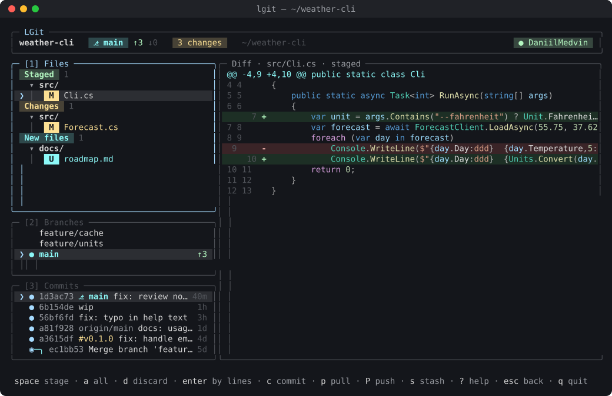
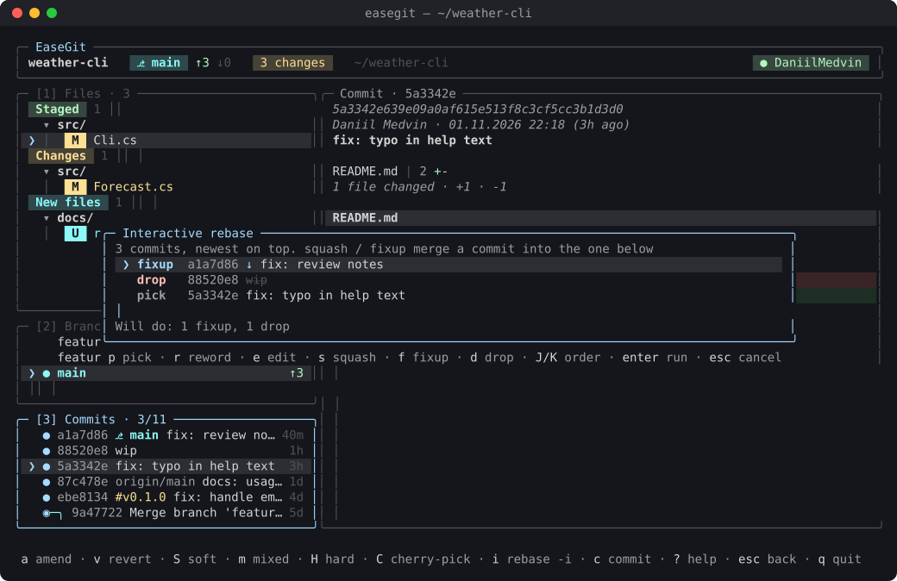
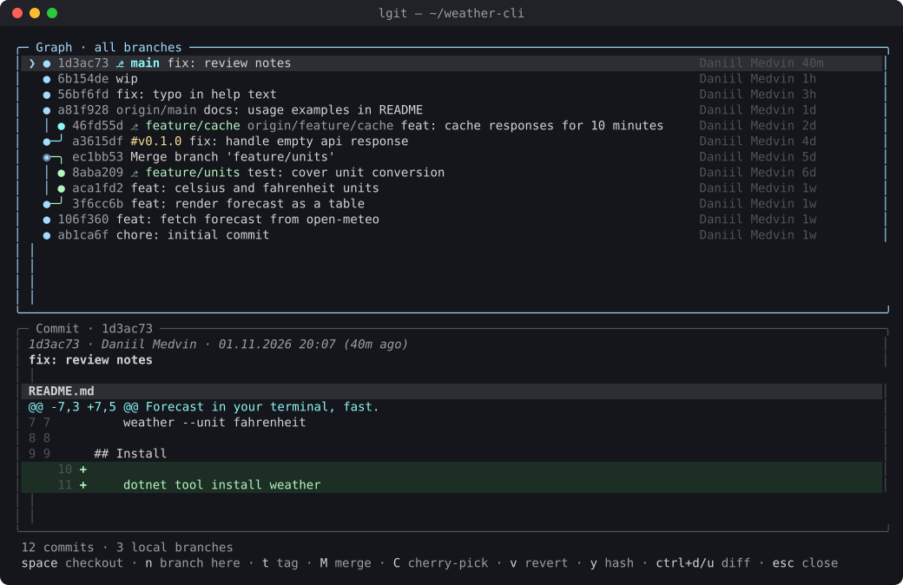
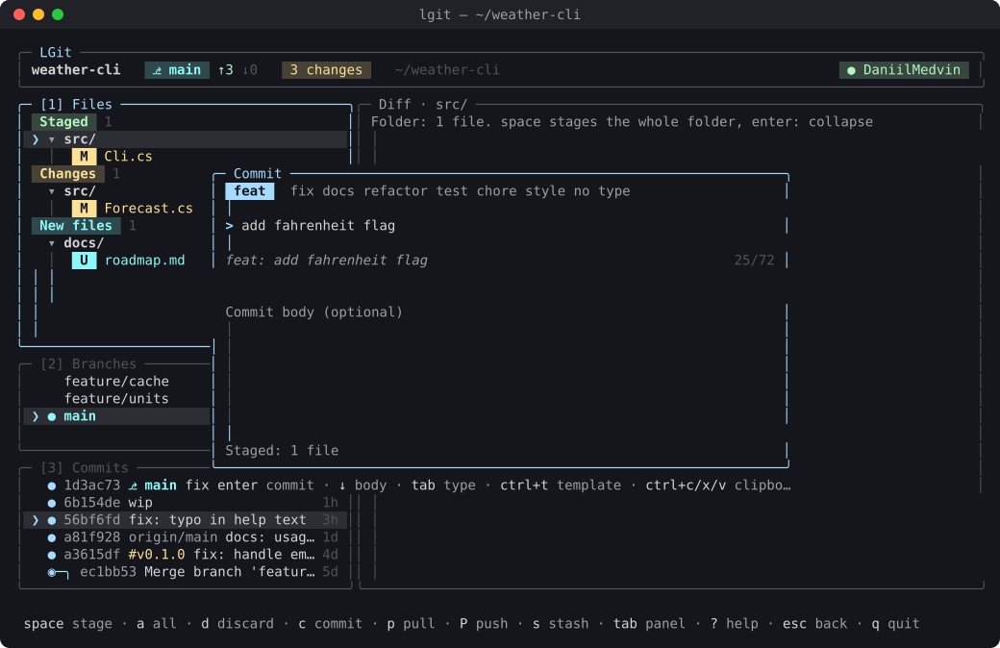

# EaseGit

[](https://github.com/DaniilMedvin/EaseGit/actions/workflows/ci.yml)
[](https://github.com/DaniilMedvin/EaseGit/releases/latest)
[](LICENSE)

A calm, keyboard-driven git client for the terminal, written in C# on .NET 10 and Terminal.Gui v2.

**English** · [Русский](README.ru.md)



## Made for C# / .NET

EaseGit works with any git repository, but it is tuned for C# developers:

- **C# syntax highlighting in diffs** is powered by Roslyn, the real C# compiler (`Microsoft.CodeAnalysis`), with the
  Visual Studio dark theme colors. Other languages are shown as a plain colored diff.
- **`.gitignore` for .NET in one key** (`I`): the latest official
  [VisualStudio.gitignore](https://github.com/github/gitignore/blob/main/VisualStudio.gitignore) from GitHub,
  with a built-in copy when offline.
- Ignores `bin/`, `obj/` and `.vs/` noise out of the box once that `.gitignore` is in place.

Highlighting for more languages is a welcome contribution, see [CONTRIBUTING.md](CONTRIBUTING.md).

## Features

- **Files**: staged / changes / new / conflicts, folder tree, stage a file, a folder or everything, discard with confirmation.
- **Line-by-line staging**: `enter` on a file, then stage, unstage or discard single lines, selections (`v`) or hunks.
- **Diff** with line numbers, word wrap for long lines (`w`) and syntax highlighting in the Visual Studio dark style: C#, project files and XAML,
  Razor, JSON; NuGet version changes in project files are called out above the diff (major bumps highlighted);
  `ctrl+e` adds which C# classes and methods were added, changed or removed (Roslyn, formatting-only edits are ignored).
- **Commits** in the style of Conventional Commits: type picker, live preview, length counter, templates (`ctrl+t`),
  on request a message drafted from the changed C# classes and methods (`ctrl+e`), and `Fixes #12` for an open issue (`ctrl+k`).
- **Branches**: checkout, create, merge, delete (with a second confirmation for unmerged ones), cherry-pick;
  the selected branch's `git log --graph` is shown on the right in color (HEAD, branches, tags) without checkout.
- **Commit view**: full hash, message and a `git show --stat` style summary (`path | 12 ++++----`) above the diff.
- **Mouse wheel** scrolls the diff; panel titles show counts and the position (`[3] Commits · 4/120`).
- **History**: amend, fix an older commit with staged changes (`F`: fixup + autosquash), reset soft / mixed / hard, revert, cherry-pick, **interactive rebase** (pick, reword, edit, squash, fixup, drop, reorder).
- **Graph of all branches** (`G`) with per-branch colors, tags and actions on any commit; branches merged by rebase or
  squash are recognized and labelled `≈ merged into main as a1b2c3d` instead of a dangling line (`X` cleans them up).
- **Sync**: fetch, pull, push with `↑ahead ↓behind`, a spinner, `esc` to cancel, and a guided `push -u` for new branches.
- **Conflicts**: resolve block by block (`enter` on a conflicted file: ours / theirs / both for each `<<<<<<<` block)
  or keep ours / theirs / both for the whole file, continue (`C`) or abort (`A`) merge, cherry-pick, revert and rebase.
- **GitHub pull requests** (`g`): PRs of this repository, your PRs and review requests across all repositories,
  with CI and review status, description, checks and diff; checkout, merge (squash / merge / rebase), approve,
  open in browser; create a PR from the current branch (`N`) with the title and description taken from commits;
  `enter` on a PR of another project opens its local copy or clones it; `w` shows its Actions; `/` picks any repository
  (recent local ones, yours on GitHub or any `owner/repo`) to review and merge its PRs. CI status of HEAD in the header (`✓ CI`).
- **GitHub Issues** (the Issues tab in `g`): open issues with labels, assignees and comments; create (`n`),
  comment (`c`), close (`x`), open in browser.
- **File history** (`h` on a file, `F` for any file): every commit that changed it, following renames, with the diff of that file.
- **Search history** (`ctrl+f`): by message, author, or where a line of code appeared or disappeared (`git log -S`),
  in the current branch or all branches, results as you type.
- **Compare** branches or commits (`=`): files with +/− and diffs, commits only on one side; from the merge base
  (what a PR would contain) or between tips.
- **Blame** (`B` on a file, `b` in file history): who wrote each line and in which commit; `p` jumps to the version
  before that commit to see who wrote the line earlier.
- **Build and test** on demand (`F5`): `dotnet build` and `dotnet test` with live output, a summary and the failed tests;
  pick which tests to run by class or one by one (`space`, `a` for all).
- **GitHub Actions** (`ctrl+o`): runs of the branch, jobs and steps, the log of failed steps right in EaseGit,
  rerun failed jobs or the whole run, cancel; refreshes itself while something is running.
- **Worktrees** (`W`): working folders for other branches — list with their state, create, open in EaseGit, delete, prune.
- **Undo** (`z`) of the last commit, amend, merge, pull or checkout through reflog.
- **Stash**: save with a message (everything or only the selected file or folder, `S`), pop, apply, drop, see its diff.
- **Tags** (`#`): list, create on HEAD (annotated with a message), push, delete locally or on the server.
- **Branches, more**: rename (`R`), skip the current commit of rebase / cherry-pick / revert (`K`), the commit log loads more as you scroll.
- **Transparency**: every action shows the exact git command before it runs; the Command Log (`~`) shows what ran.
- **Command palette** (`ctrl+p` or `:`) with fuzzy search, help (`?`) generated from the actual key bindings.
- **Themes** (dark, light, your own) and **remappable keys** in `config.json`; **English and Russian** UI (`L` switches).

| Interactive rebase | Graph of all branches |
|---|---|
|  |  |

## Install

Download a single self-contained binary from [Releases](https://github.com/DaniilMedvin/EaseGit/releases/latest), no .NET needed.

```sh
# Linux x64
curl -L https://github.com/DaniilMedvin/EaseGit/releases/latest/download/easegit-linux-x64.tar.gz | tar xz
sudo mv easegit /usr/local/bin/

# macOS (Apple Silicon)
curl -L https://github.com/DaniilMedvin/EaseGit/releases/latest/download/easegit-osx-arm64.tar.gz | tar xz
sudo mkdir -p /usr/local/bin && sudo mv easegit /usr/local/bin/
```

### macOS

The build is for Apple Silicon (M1 and newer); on Intel Macs build from source (see below).
`/usr/local/bin` may be missing on a fresh Mac, so the command above creates it.

Installed with `curl` as above, `easegit` just runs. If you downloaded the archive **in a browser**, macOS marks it
as quarantined and refuses to open it ("cannot verify the developer"), because the binary is not notarized by Apple.
Remove the mark once:

```sh
xattr -d com.apple.quarantine easegit
```

or in Finder: right-click `easegit` → **Open** → **Open**.

### Windows

In PowerShell: download, unpack to `%LOCALAPPDATA%\Programs\easegit` and add that folder to your user `PATH`.

```powershell
$dir = "$env:LOCALAPPDATA\Programs\easegit"
New-Item -ItemType Directory -Force $dir | Out-Null
Invoke-WebRequest https://github.com/DaniilMedvin/EaseGit/releases/latest/download/easegit-win-x64.zip -OutFile "$env:TEMP\easegit.zip"
Expand-Archive "$env:TEMP\easegit.zip" -DestinationPath $dir -Force
$path = [Environment]::GetEnvironmentVariable("Path", "User")
if ($path -notlike "*$dir*") { [Environment]::SetEnvironmentVariable("Path", "$path;$dir", "User") }
```

Open a new terminal and run `easegit`. Windows Terminal is recommended: the classic console draws box characters poorly.
The binary is not signed, so SmartScreen may warn on the first run: *More info → Run anyway*.
Install `gh` with `winget install GitHub.cli` if you want to sign in to GitHub from the app.
To update, run the same commands again; to remove, delete the folder and remove it from `PATH`.

With the GitHub CLI you can also download any release asset: `gh release download --repo DaniilMedvin/EaseGit --pattern 'easegit-linux-x64.tar.gz'`.

Requirements: `git`. Optional: [GitHub CLI](https://cli.github.com/) `gh` to sign in to GitHub from the app.

### From source

```sh
git clone https://github.com/DaniilMedvin/EaseGit.git && cd EaseGit
dotnet run --project EaseGit -- /path/to/repo
# or a single file in EaseGit/bin/Release/net10.0/linux-x64/publish/easegit
dotnet publish EaseGit -c Release -r linux-x64
```

## Usage

```sh
easegit              # repository in the current folder, or the start screen
easegit ~/projects/x # open a specific repository
```

| Key | Action | Key | Action |
|---|---|---|---|
| `1` `2` `3` `4` / `tab` | switch panel | `?` / `F1` | help with all keys |
| `space` | stage / checkout / pop | `ctrl+p` / `:` | command palette |
| `c` | commit | `p` / `P` / `f` | pull / push / fetch |
| `enter` on a file | line-by-line staging | `i` in commits | interactive rebase |
| `z` | undo last action | `G` | graph of all branches |
| `C` / `A` | continue / abort an operation | `T` / `L` | theme / language |
| `g` | GitHub pull requests | `N` | create a PR |
| `~` | Command Log | `q` | quit |

Panel-specific keys are always shown in the bottom line.



## Configuration

`~/.config/easegit/config.json`: language, theme, custom themes and key bindings. See [docs/CONFIG.md](docs/CONFIG.md).
EaseGit used to be called LGit (command `lgit`): settings from `~/.config/lazygit-cs/` are picked up automatically,
the old `lgit` binary can be deleted.

```jsonc
{
  "language": "en",
  "theme": "light",
  "keys": { "files.stage": "s", "sync.fetch": "F5" }
}
```

## Development

```sh
dotnet build
dotnet test                 # parsers on real git output + integration tests on temporary repositories
scripts/demo-repos.sh       # repositories in tricky states (conflicts, diverged branches, …) for manual checks
scripts/screenshots.sh      # re-shoot the screenshots in docs/screenshots (needs tmux and python3)
```

Project docs (in Russian): [plan](docs/PLAN.md), [architecture](docs/ARCHITECTURE.md), [conventions](docs/CONVENTIONS.md), [design](docs/DESIGN.md).

Releases are built by GitHub Actions: push a tag `v*` and binaries for Linux, Windows and macOS are attached to the release.

## Contributing

Bug reports, ideas and pull requests are welcome: see [CONTRIBUTING.md](CONTRIBUTING.md).
Only the maintainer can merge into `main`, every change goes through a reviewed pull request.

## License

[MIT](LICENSE)
