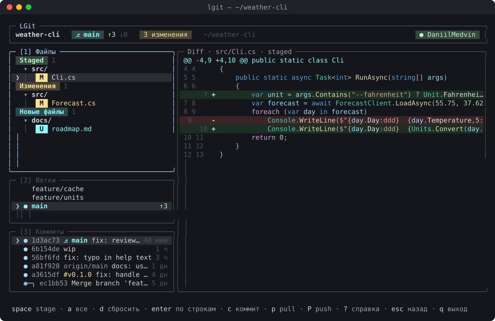
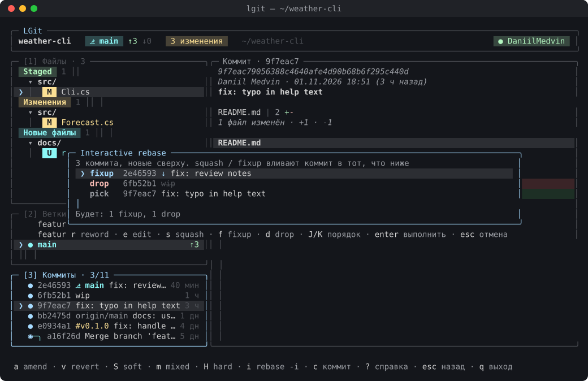
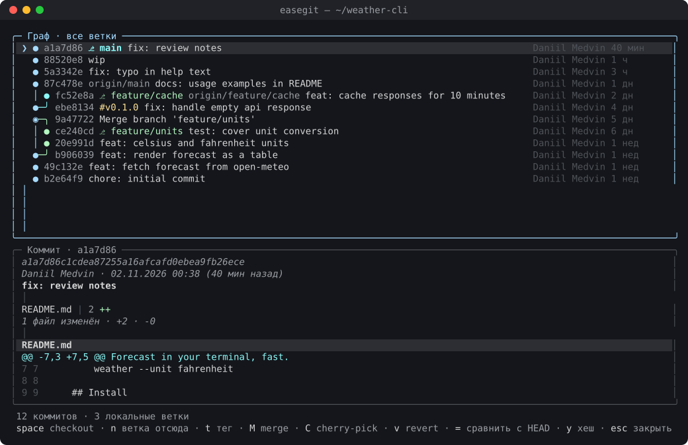
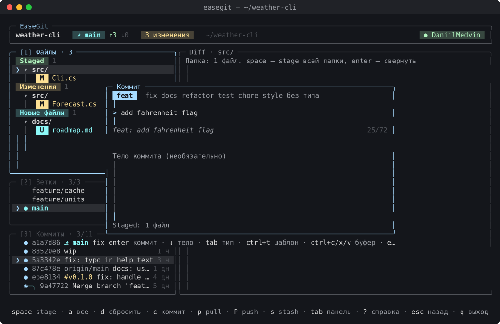

# EaseGit

[](https://github.com/DaniilMedvin/EaseGit/actions/workflows/ci.yml)
[](https://github.com/DaniilMedvin/EaseGit/releases/latest)
[](LICENSE)

Спокойный git-клиент для терминала, который управляется с клавиатуры. C#, .NET 10, Terminal.Gui v2.

[English](README.md) · **Русский**



## Сделан для C# / .NET

EaseGit работает с любым git-репозиторием, но заточен под C#-разработчиков:

- **Подсветка C# в diff** работает на Roslyn — настоящем компиляторе C# (`Microsoft.CodeAnalysis`) — в цветах
  тёмной темы Visual Studio. Остальные языки показываются обычным цветным diff.
- **`.gitignore` для .NET одной клавишей** (`I`): актуальный официальный
  [VisualStudio.gitignore](https://github.com/github/gitignore/blob/main/VisualStudio.gitignore) с GitHub,
  без сети — встроенная копия.
- **`.editorconfig` одной клавишей** (`E`): стандартный из установленного .NET SDK (`dotnet new editorconfig`): отступы,
  порядок `using` и стиль кода — по ним работает `dotnet format`; без `dotnet` — встроенная копия.
- С таким `.gitignore` мусор из `bin/`, `obj/` и `.vs/` не попадает в список файлов.

Подсветку других языков можно добавить — см. [CONTRIBUTING.md](CONTRIBUTING.md).

## Возможности

- **Файлы**: staged / изменения / новые / конфликты, дерево папок, stage файла, папки или всего сразу, сброс с подтверждением.
- **Построчный stage**: `enter` на файле, затем stage, unstage или сброс отдельных строк, выделения (`v`) или фрагмента.
- **Diff** с номерами строк, переносом длинных строк (`w`) и подсветкой в стиле тёмной темы Visual Studio: C#, файлы проектов и XAML, Razor, JSON;
  смена версий NuGet в файле проекта — заметкой над diff (мажорные обновления выделены);
  `ctrl+e` — какие классы и методы C# добавлены, изменены или удалены (Roslyn, правка только форматирования не считается).
- **Коммиты** по Conventional Commits: выбор типа, предпросмотр, счётчик длины, шаблоны (`ctrl+t`),
  по запросу — заготовка сообщения по изменённым классам и методам C# (`ctrl+e`) и `Fixes #12` для открытого issue (`ctrl+k`).
- **Ветки**: checkout, создание, merge, удаление (для невлитой — второе подтверждение), cherry-pick;
  справа цветной `git log --graph` выбранной ветки (HEAD, ветки, теги) — без checkout.
- **Просмотр коммита**: полный хеш, сообщение и сводка как `git show --stat` (`путь | 12 ++++----`) над diff.
- **Мышь**: клик — фокус в панель и выбор строки, двойной клик — как `enter`, клик по стрелке папки — свернуть,
  колесо листает diff; в заголовках панелей счётчики и позиция (`[3] Коммиты · 4/120`).
- **История**: amend, исправить старый коммит staged-изменениями (`F`: fixup + autosquash), reset soft / mixed / hard, revert, cherry-pick, **interactive rebase** (pick, reword, edit, squash, fixup, drop, перестановка).
- **Граф всех веток** (`G`): цвет за каждой веткой, теги и действия над любым коммитом; ветки, влитые через rebase
  или squash, распознаются и подписаны `≈ влита в main как a1b2c3d` вместо обрыва линии (`X` — удалить их).
- **Синхронизация**: fetch, pull, push с `↑ahead ↓behind`, спиннером и отменой по `esc`, подсказка `push -u` для новой ветки.
- **Конфликты**: по блокам (`enter` на конфликтном файле: наша / их / обе для каждого блока `<<<<<<<`)
  или целиком — наша / их / обе версии файла, продолжить (`C`) или прервать (`A`) merge, cherry-pick, revert и rebase.
- **Pull request на GitHub** (`g`): PR этого репозитория, мои PR и ждущие моего ревью по всем репозиториям —
  со статусом CI и ревью, описанием, проверками и diff; checkout, merge (squash / merge / rebase), approve,
  открыть в браузере; создать PR из текущей ветки (`N`) — заголовок и описание берутся из коммитов;
  `enter` на PR другого проекта открывает его локальную копию или клонирует его; `/` — выбрать любой
  репозиторий (недавние локальные, свои на GitHub или любой `владелец/репо`), чтобы посмотреть и влить его PR. Статус CI для HEAD в шапке (`✓ CI`).
  После merge PR этого репозитория EaseGit сам делает fetch и перематывает локальную базовую ветку (только fast-forward).
- **Комментарии ревью** прямо в diff PR: обсуждения под своими строками, решённые свёрнуты в одну строку; `d` — в diff,
  `n` / `N` — следующее / предыдущее обсуждение, `c` — ответить или прокомментировать строку под курсором, `x` — решено / открыть.
- **Issues на GitHub** (вкладка Issues в `g`): открытые issues с метками, исполнителями и комментариями; создать (`n`),
  прокомментировать (`c`), закрыть (`x`), открыть в браузере.
- **История файла** (`h` на файле, `F` — любой файл): все коммиты, менявшие его, через переименования, с diff этого файла.
- **Поиск по истории** (`ctrl+f`): по сообщению, автору или где строка кода появилась или исчезла (`git log -S`),
  в текущей ветке или во всех, результаты по мере ввода.
- **Фильтр в панелях** (`/` в файлах или коммитах): файлы по пути, коммиты по заголовку, автору, хешу, ветке или тегу —
  по мере ввода; `enter` оставляет фильтр (виден в заголовке панели, `/panel 3 из 22`), `esc` сбрасывает, выбор остаётся.
- **Сравнение** веток или коммитов (`=`): файлы с +/− и diff, коммиты только в одной стороне; от общего предка
  (что войдёт в PR) или между вершинами.
- **Blame** (`B` на файле, `b` в истории файла): кто и в каком коммите написал каждую строку; `p` — версия до этого
  коммита, чтобы увидеть, кто написал строку раньше.
- **Сборка, тесты и форматирование** по клавише (`F5`): сразу запускается только `dotnet build` с выводом по мере
  выполнения и итогом; `enter` — выбранные тесты, `r` — пересборка с нуля, `f` — `dotnet format`.
  Какие тесты гонять — выбор по классам или по одному (`space`, `a` — все).
- **GitHub Actions** (`ctrl+o`): запуски ветки, jobs и шаги, лог упавших шагов прямо в EaseGit, перезапуск упавших
  или всего запуска, отмена; пока что-то идёт, обновляется само.
- **Worktrees** (`W`): рабочие папки для других веток — список с состоянием, создать, открыть в EaseGit, удалить, убрать пропавшие.
- **Отмена** (`z`) последнего коммита, amend, merge, pull или checkout через reflog.
- **Stash**: сохранить с сообщением (всё или только выбранный файл или папку, `S`), pop, apply, удалить, посмотреть diff.
- **Теги** (`#`): список, создать на HEAD (с сообщением — аннотированный), push, удалить локально или на сервере.
  **Релизы на GitHub** прямо из тега (`R`): заметки из коммитов с прошлого тега по типам Conventional Commits
  (или их составит GitHub, `--generate-notes`); тег сначала отправится, если нужно; у тегов с релизом — метка.
- **Ещё про ветки**: переименовать (`R`), пропустить текущий коммит rebase / cherry-pick / revert (`K`), лог коммитов подгружается при прокрутке.
- **Прозрачность**: перед каждым действием видна точная git-команда, а Command Log (`~`) показывает, что выполнено.
- **Палитра команд** (`ctrl+p` или `:`) с нечётким поиском, справка (`?`) строится из реальных клавиш.
- **Темы** (тёмная, светлая, свои) и **свои клавиши** в `config.json`; интерфейс **на русском и английском** (`L` переключает).
- **Свои команды** в `config.json`: клавиша запускает команду shell с подстановками `{file}`, `{commit}`, `{branch}` и др.
  (открыть файл в Rider, запустить скрипт) — в фоне или с окном вывода.

| Interactive rebase | Граф всех веток |
|---|---|
|  |  |

## Установка

Один исполняемый файл со всем нужным: скачай его из [Releases](https://github.com/DaniilMedvin/EaseGit/releases/latest), .NET не нужен.

```sh
# Linux x64
curl -L https://github.com/DaniilMedvin/EaseGit/releases/latest/download/easegit-linux-x64.tar.gz | tar xz
sudo mv easegit /usr/local/bin/

# macOS (Apple Silicon)
curl -L https://github.com/DaniilMedvin/EaseGit/releases/latest/download/easegit-osx-arm64.tar.gz | tar xz
sudo mkdir -p /usr/local/bin && sudo mv easegit /usr/local/bin/
```

### macOS

Сборка для Apple Silicon (M1 и новее); на Mac с Intel собери из исходников (см. ниже).
На новом Mac папки `/usr/local/bin` может не быть — команда выше её создаёт.

Если ставить через `curl`, как выше, `easegit` просто запускается. Если архив скачан **в браузере**, macOS помечает
его как скачанный из интернета и не даёт открыть («не удалось проверить разработчика»): файл не нотаризован Apple.
Сними пометку один раз:

```sh
xattr -d com.apple.quarantine easegit
```

или в Finder: правый клик по `easegit` → **Открыть** → **Открыть**.

### Windows

В PowerShell: скачать, распаковать в `%LOCALAPPDATA%\Programs\easegit` и добавить эту папку в пользовательский `PATH`.

```powershell
$dir = "$env:LOCALAPPDATA\Programs\easegit"
New-Item -ItemType Directory -Force $dir | Out-Null
Invoke-WebRequest https://github.com/DaniilMedvin/EaseGit/releases/latest/download/easegit-win-x64.zip -OutFile "$env:TEMP\easegit.zip"
Expand-Archive "$env:TEMP\easegit.zip" -DestinationPath $dir -Force
$path = [Environment]::GetEnvironmentVariable("Path", "User")
if ($path -notlike "*$dir*") { [Environment]::SetEnvironmentVariable("Path", "$path;$dir", "User") }
```

Открой новый терминал и набери `easegit`. Лучше в Windows Terminal: старая консоль плохо рисует рамки.
Файл не подписан, поэтому при первом запуске SmartScreen может предупредить: *Подробнее → Выполнить в любом случае*.
Чтобы входить в GitHub из приложения, поставь `gh`: `winget install GitHub.cli`.
Обновить — выполнить те же команды ещё раз; удалить — стереть папку и убрать её из `PATH`.

Через GitHub CLI можно скачать любой файл релиза: `gh release download --repo DaniilMedvin/EaseGit --pattern 'easegit-linux-x64.tar.gz'`.

Нужен `git`. По желанию — [GitHub CLI](https://cli.github.com/) `gh`, чтобы входить в GitHub из приложения.

### Из исходников

```sh
git clone https://github.com/DaniilMedvin/EaseGit.git && cd EaseGit
dotnet run --project EaseGit -- /путь/к/репозиторию
# или один файл в EaseGit/bin/Release/net10.0/linux-x64/publish/easegit
dotnet publish EaseGit -c Release -r linux-x64
```

## Запуск

```sh
easegit              # репозиторий в текущей папке или стартовый экран
easegit ~/projects/x # открыть конкретный репозиторий
```

| Клавиша | Действие | Клавиша | Действие |
|---|---|---|---|
| `1` `2` `3` `4` / `tab` | переход между панелями | `?` / `F1` | справка со всеми клавишами |
| `space` | stage / checkout / pop | `ctrl+p` / `:` | палитра команд |
| `c` | коммит | `p` / `P` / `f` | pull / push / fetch |
| `enter` на файле | построчный stage | `i` в коммитах | interactive rebase |
| `z` | отменить последнее действие | `G` | граф всех веток |
| `C` / `A` | продолжить / прервать операцию | `T` / `L` | тема / язык |
| `g` | pull request на GitHub | `N` | создать PR |
| `~` | Command Log | `q` | выход |

Клавиши текущей панели всегда видны в нижней строке.



## Настройки

`~/.config/easegit/config.json`: язык, тема, свои темы, клавиши и фоновый fetch (по умолчанию раз в 5 минут,
`"autoFetchMinutes": 0` — выключить). Подробнее — [docs/CONFIG.md](docs/CONFIG.md).
Раньше EaseGit назывался LGit (команда `lgit`): настройки из `~/.config/lazygit-cs/` подхватываются сами,
старый файл `lgit` можно удалить.

```jsonc
{
  "language": "ru",
  "theme": "light",
  "keys": { "files.stage": "s", "sync.fetch": "F5" }
}
```

## Разработка

```sh
dotnet build
dotnet test                 # парсеры на реальном выводе git + интеграционные тесты на временных репозиториях
scripts/demo-repos.sh       # репозитории в сложных состояниях (конфликты, разошедшиеся ветки…) для ручной проверки
scripts/screenshots.sh      # переснять скриншоты в docs/screenshots (нужны tmux и python3)
```

Документация проекта: [план](docs/PLAN.md), [архитектура](docs/ARCHITECTURE.md), [соглашения](docs/CONVENTIONS.md), [дизайн](docs/DESIGN.md).

Релизы собирает GitHub Actions: отправь тег `v*`, и к релизу приложатся бинарники для Linux, Windows и macOS.

## Участие

Сообщения об ошибках, идеи и pull request приветствуются: см. [CONTRIBUTING.md](CONTRIBUTING.md).
Вливать в `main` может только автор, каждое изменение проходит через проверенный pull request.

## Лицензия

[MIT](LICENSE)
